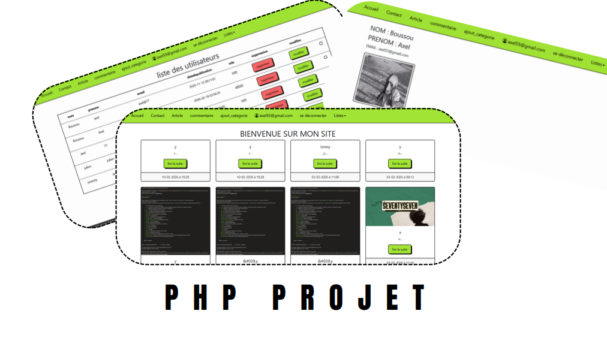

# Blog PHP avec Twig

Petit site de blog réalisé en PHP dans le cadre du cours de PHP (EPSI, 1ére année BTS SIO).
Il permet de publier des articles, de les commenter, de gérer des catégories et des utilisateurs.

Le HTML est entièrement séparé du PHP grâce au moteur de templates [Twig](https://twig.symfony.com/).

## Aperçu



## Fonctionnalités

- **Articles** : liste sur l'accueil, lecture, ajout avec image, modification
- **Commentaires** : les utilisateurs connectés peuvent commenter un article
- **Comptes** : inscription, connexion, déconnexion, profil (mot de passe, email, photo)
- **Administration** (rôle `admin`) : gestion des catégories et des utilisateurs
- **Contact** : formulaire de contact et liste des messages reçus

## Technologies

- PHP 8.1 ou plus, avec l'extension `pdo_mysql`
- MariaDB / MySQL
- Twig 3 (installé avec Composer)
- Bootstrap 5 (thème Bootswatch « Brite »)

## Organisation du projet

```
classes/     les classes qui parlent à la base de données (Article, User, Categorie, Commentaire, Contact)
db/          la connexion à la base de données
fonctions/   les fonctions communes (redirection, envoi d'image)
pages/       la logique de chaque page, sans HTML
templates/   les templates Twig, un par page
public/      le seul dossier accessible depuis le navigateur (index.php et images)
```

### Comment une page s'affiche

1. Toutes les adresses passent par `public/index.php?page=nom`.
2. `index.php` ouvre la session, charge les classes et Twig, puis appelle `pages/nom.php`.
3. Le fichier de `pages/` traite les formulaires, interroge la base grâce aux classes et prépare les données.
4. Il termine par `$twig->render('nom.html.twig', [...])` : c'est le template qui produit le HTML.

Tous les templates héritent de `templates/base.html.twig`, qui contient le menu et affiche les messages
(erreurs, confirmations) que les pages rangent dans le tableau `$messages`.

Si la page demandée n'existe pas, `error404` est affichée. Si la base de données est injoignable, c'est `maintenance`.

## Installation

1. Récupérer le projet et installer Twig :

   ```bash
   git clone git@github.com:axel77bd/php.git
   cd php
   composer install
   ```

2. Créer une base de données et renseigner ses identifiants dans `db/mariadb.php`.

3. Créer les tables (voir ci-dessous).

4. Faire pointer le serveur web sur le dossier `public/`, ou lancer le serveur intégré de PHP :

   ```bash
   php -S localhost:8000 -t public
   ```

5. Le serveur web doit avoir le droit d'écrire dans `public/images` pour l'envoi des images.

## Base de données

Le dépôt ne contient pas d'export SQL. Voici les tables et les colonnes utilisées par le code :

| Table | Colonnes |
|---|---|
| `Article` | `id`, `sujet`, `contenu`, `datedepublication`, `image`, `anciennom` |
| `categorie` | `id`, `nom` |
| `commentaire` | `id`, `titre`, `contenu`, `datedepublication`, `moderer`, `idarticle`, `iduser` |
| `user` | `id`, `nom`, `prenom`, `email`, `password`, `datedepublication`, `role`, `image` |
| `conctact` | `id`, `sujet`, `email`, `contenu` |

Le rôle d'un utilisateur vaut `user` à l'inscription. Pour créer le premier administrateur,
il faut passer son rôle à `admin` directement dans la base.

## Sécurité

- Les mots de passe sont hashés avec `password_hash`.
- Les requêtes SQL sont préparées avec PDO.
- Twig échappe automatiquement tout ce qui est affiché avec `{{ }}`.
- Le nom de page reçu dans l'URL est filtré avant d'inclure un fichier.

## Auteur

Axel Boussou
